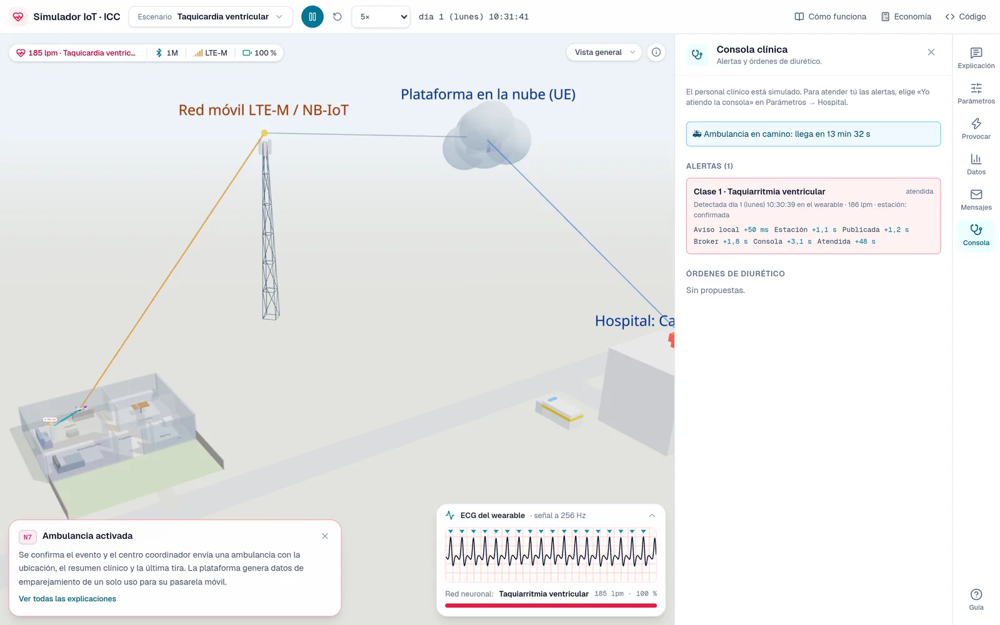
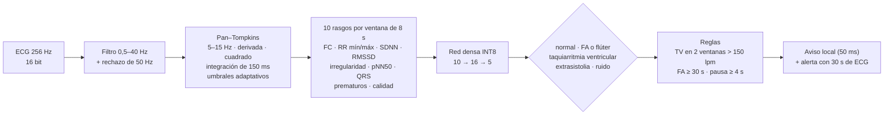
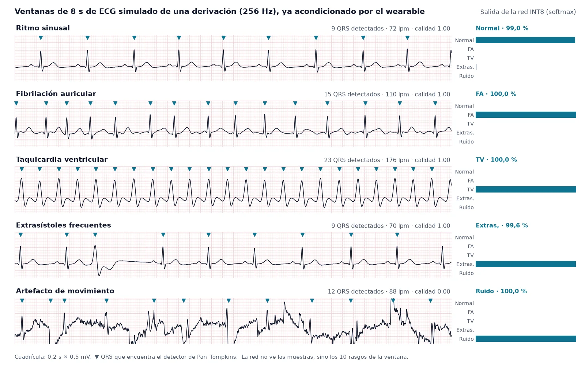
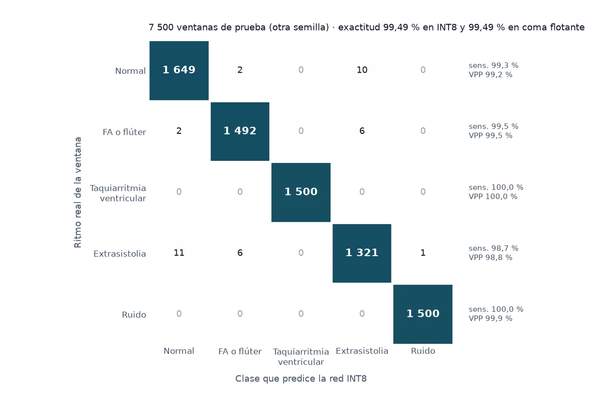
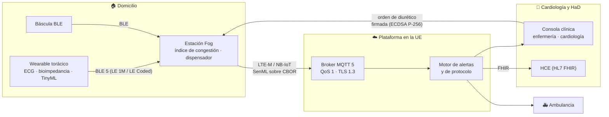
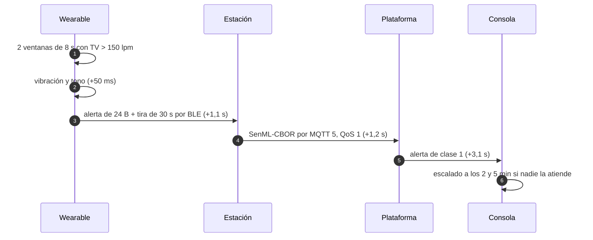
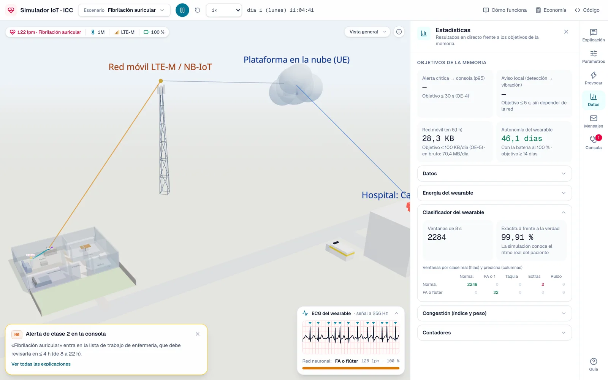
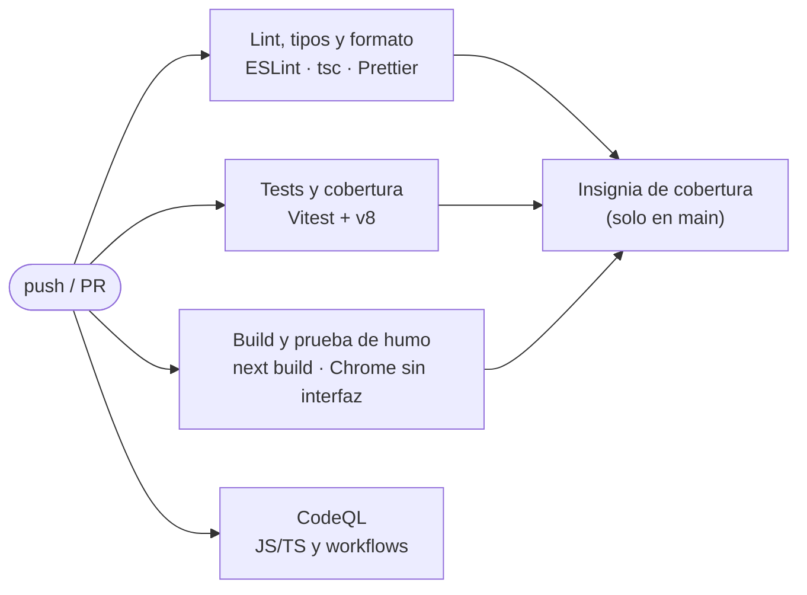

<div align="center">


# Simulador IoT · Insuficiencia cardíaca

**Una red neuronal en un parche torácico lee el ECG cada 8 s y avisa de una arritmia peligrosa en 50 ms**,
dentro de una simulación 3D del sistema IoT Edge–Fog–Cloud completo que monitoriza en casa a pacientes con
insuficiencia cardíaca.

[](https://github.com/Pablo-Caballero-Maria/simulador-iot-icc/actions/workflows/ci.yml)
[](https://github.com/Pablo-Caballero-Maria/simulador-iot-icc/actions/workflows/codeql.yml)
[](https://github.com/Pablo-Caballero-Maria/simulador-iot-icc/actions/workflows/ci.yml)
[](https://github.com/Pablo-Caballero-Maria/simulador-iot-icc/releases)
[](LICENSE)
[](https://simulador-iot-icc.vercel.app)


[**Abrir el simulador**](https://simulador-iot-icc.vercel.app) · [Memoria (PDF)](memoria/memoria.pdf) ·
[Wiki](https://github.com/Pablo-Caballero-Maria/simulador-iot-icc/wiki) · [Arquitectura](docs/ARQUITECTURA.md) ·
[Registro de cambios](CHANGELOG.md) ·
[Resumen en mi portfolio](https://pablo-portfolio-woad.vercel.app/projects/heart-failure-ai)



</div>

Simulación 3D e interactiva de un sistema IoT Edge–Fog–Cloud para monitorizar en casa a pacientes dados de alta tras un
ingreso por insuficiencia cardíaca. Acompaña a la memoria del trabajo final de la asignatura _Internet of Things_ (Máster
Universitario en Inteligencia Computacional e IoT, Universidad de Córdoba), que está en [`memoria/`](memoria/).

La web no es una animación: ejecuta un modelo del sistema completo, desde el corazón del paciente hasta la consola del
hospital, y cada mensaje que se ve viajar lleva bytes reales codificados con su protocolo.

| 🎯 Exactitud de la red | 🧠 Parámetros | ⚡ Aviso local | 📉 Datos por la red móvil  | 🔋 Autonomía del wearable | 🏥 Antelación de la congestión |
| :--------------------: | :-----------: | :------------: | :------------------------: | :-----------------------: | :----------------------------: |
| 99,5 % (INT8 = float)  |  261 (INT8)   |     50 ms      | 86 KB/día (frente a 70 MB) |      46 días (×3,2)       |            5,2 días            |

> [!IMPORTANT]
> Los datos fisiológicos son **sintéticos** y el simulador **no es un producto sanitario**: los resultados demuestran
> que la lógica del sistema funciona, no su eficacia clínica.

## Índice

- [La red neuronal del wearable](#la-red-neuronal-del-wearable)
- [El sistema completo](#el-sistema-completo)
- [Uso](#uso)
- [Scripts](#scripts)
- [Estructura](#estructura)
- [Calidad e integración continua](#calidad-e-integración-continua)
- [Documentación](#documentación)
- [Contribuir](#contribuir)
- [Cómo citar](#cómo-citar)
- [Tecnologías y licencia](#tecnologías-y-licencia)

## La red neuronal del wearable

El parche registra un ECG de una derivación a 256 Hz y 16 bit y lo analiza en el propio dispositivo:



| Capa                                    | Salida | Parámetros |   MAC   |
| --------------------------------------- | :----: | :--------: | :-----: |
| Entrada: 10 rasgos de la ventana (INT8) |   10   |     —      |    —    |
| Densa + ReLU                            |   16   |    176     |   160   |
| Densa + softmax                         |   5    |     85     |   80    |
| **Total**                               |        |  **261**   | **240** |

- **Entrenamiento** (`npm run train:classifier`, escrito desde cero en TypeScript): 22 500 ventanas sintéticas
  generadas por la misma cadena que usa la simulación, Adam con entropía cruzada y regularización L2, 80 épocas.
- **Cuantización a INT8** tras el entrenamiento: pesos con una escala por neurona, entradas y capa oculta calibradas
  con el percentil 99,9, sesgos int32 e inferencia solo con aritmética entera, como TensorFlow Lite Micro.
- **Resultado**: con 7 500 ventanas de prueba de otra semilla acierta el **99,49 %**, igual en INT8 que en coma
  flotante, con una sensibilidad del 100 % en taquiarritmia ventricular.

<p align="center">
  
</p>

<details>
<summary><b>Matriz de confusión del modelo INT8</b></summary>

<p align="center">
  
</p>

</details>

En paralelo, la estación de casa calcula cada mañana un **índice de congestión** que compara con la línea basal del
propio paciente el peso (30 %), la impedancia torácica nocturna (35 %), la respiración nocturna (20 %) y la actividad
(15 %); por encima de 50 genera una alerta. En la descompensación simulada avisa **5,2 días antes** del ingreso que se
habría producido. Todo el detalle, en la wiki:
[La red neuronal del wearable](https://github.com/Pablo-Caballero-Maria/simulador-iot-icc/wiki/La-red-neuronal-del-wearable)
y [El índice de congestión](https://github.com/Pablo-Caballero-Maria/simulador-iot-icc/wiki/El-%C3%ADndice-de-congesti%C3%B3n).

> [!NOTE]
> La red solo se ha probado con señales sintéticas del mismo modelo con el que se entrena. Un producto real se
> entrenaría con PhysioNet y registros del propio parche, y se evaluaría con pacientes distintos siguiendo AAMI EC57.

## El sistema completo



| Nivel (IoT World Forum) | Qué se simula                                                                                                              |
| ----------------------- | -------------------------------------------------------------------------------------------------------------------------- |
| N1 Dispositivos         | Paciente con ritmo cardíaco, congestión, peso, impedancia y rutina por la casa; wearable, báscula y dispensador            |
| N2 Conectividad         | BLE (LE 1M / LE Coded, alcance, reconexión) y LTE-M / NB-IoT (cobertura, caudal, retardo, cortes)                          |
| N3 Edge / Fog           | ECG a 256 Hz, detector de QRS de Pan–Tompkins, red neuronal INT8 de 261 parámetros, reglas de alerta, índice de congestión |
| N4 Acumulación          | MQTT 5 con QoS 1 sobre TLS 1.3, envío diferido, ingesta idempotente                                                        |
| N5 Abstracción          | SenML sobre CBOR (RFC 8428 y 8949) y observaciones HL7 FHIR con códigos LOINC                                              |
| N6 Aplicación           | Motor de alertas con escalado y propuesta de diurético firmada con ECDSA P-256 (autonomía A3)                              |
| N7 Procesos             | Enfermería, cardiología, centro coordinador y ambulancia                                                                   |

<details>
<summary><b>Recorrido de una alerta crítica (taquicardia ventricular)</b></summary>



Con LTE-M, la alerta llega a la consola en 2,8 s de mediana (p95 de 4,0 s); con NB-IoT, en 16,6 s (p95), frente a un
objetivo de 30 s.

</details>

## Uso

```bash
npm install
npm run dev          # http://localhost:3000
```

La escena 3D ocupa toda la pantalla y solo muestra lo imprescindible: el estado resumido (ritmo, BLE, red móvil y
batería), la última explicación y el ECG del wearable. En la barra superior se elige el escenario, la velocidad y se
pausa o reinicia; cada escenario explica qué observar:

| Escenario                      | Qué observar                                                                        |
| ------------------------------ | ----------------------------------------------------------------------------------- |
| Un día normal                  | vectores horarios, pesaje, toma basal y paseo fuera de alcance; KB al día, no MB    |
| Taquicardia ventricular        | aviso local sin esperar a la red, alerta en la consola en segundos y ambulancia     |
| Fibrilación auricular          | alerta de clase 2 a los 32 s, confirmada con la tira en la estación                 |
| Pausa de 6 segundos            | una regla independiente de la red neuronal salta a los 4 s                          |
| Descompensación congestiva     | diez días en un minuto: índice de congestión, diurético firmado y ningún ingreso    |
| Corte de la red móvil          | alarma local, SMS de respaldo a los 30 s y envío diferido al volver la red          |
| Fuera de casa                  | FA lejos de la estación: LE Coded, datos guardados en la flash y enviados al volver |
| Seguridad: órdenes falsas      | el dispensador rechaza una firma inventada y una orden repetida                     |
| Escenario base: todo a la nube | 70 MB al día, menos batería y un aviso que depende de la red                        |
| Batería baja                   | avisos al 20 % y al 10 % y modo de solo alarmas al 5 %                              |

El resto de la información se abre bajo demanda, de una en una, desde la barra lateral:

| Panel       | Qué muestra                                                                      |
| ----------- | -------------------------------------------------------------------------------- |
| Explicación | Historial de lo que ocurre, etiquetado con su nivel del modelo, y «qué observar» |
| Parámetros  | Los parámetros del diseño (valores por defecto de la memoria), por grupos        |
| Provocar    | Arritmias, artefactos, corte de red, báscula usada por otra persona, ataques     |
| Datos       | Objetivos de la memoria en directo; datos, energía, clasificador y congestión    |
| Mensajes    | Cada paquete con sus bytes, cabeceras, CBOR y FHIR                               |
| Consola     | Alertas con la cadena de retardos y órdenes de diurético para firmar             |
| Guía        | Recorrido guiado por los siete niveles del IoT World Forum                       |

<p align="center">
  
</p>

## Scripts

| Script                     | Para qué                                                                            |
| -------------------------- | ----------------------------------------------------------------------------------- |
| `npm run dev`              | Servidor de desarrollo                                                              |
| `npm run build` / `start`  | Compilación y servidor de producción                                                |
| `npm test`                 | Tests unitarios y de integración (Vitest)                                           |
| `npm run test:coverage`    | Tests con cobertura                                                                 |
| `npm run test:e2e`         | Prueba de humo en Chrome sin interfaz (requiere `npm run build` y Chrome instalado) |
| `npm run check`            | Lint, tipos, formato y tests                                                        |
| `npm run train:classifier` | Vuelve a entrenar y cuantizar la red del wearable                                   |
| `npm run results`          | Ejecuta todos los escenarios con varias semillas y guarda las cifras de la memoria  |

## Estructura

```
src/
  sim/            Motor de simulación (TypeScript puro, sin React)
    core/         Planificador de eventos, generador aleatorio, tiempo, estadística
    physiology/   Paciente, ritmo cardíaco, síntesis de ECG, geometría de la casa
    wearable/     DSP, rasgos, red INT8, reglas, energía, formatos binarios
    network/      BLE, red móvil, coste TLS/TCP/IP
    protocols/    CBOR, SenML, MQTT 5, FHIR
    station/      Estación Fog, índice de congestión, dispensador, báscula
    cloud/        Plataforma (broker, alertas, protocolo) y firma de órdenes
    simulation.ts Ensamblado y avance del sistema
    scenarios.ts  Escenarios guiados
    economics.ts  Modelo económico (apartado 6.15)
  components/     Interfaz: escena 3D (React Three Fiber), paneles y páginas
  lib/            Estado (zustand) y bucle de simulación en el navegador
  app/            Rutas de Next.js: /, /como-funciona, /economia; icono de la web
scripts/          Entrenamiento del clasificador, resultados y prueba de humo
docs/             Arquitectura del motor (ARQUITECTURA.md) y figuras del README (img/)
memoria/          Memoria del trabajo (PDF) y sus figuras
```

La documentación técnica del motor está en [`docs/ARQUITECTURA.md`](docs/ARQUITECTURA.md).

## Calidad e integración continua

Cada _push_ y _pull request_ pasa por [GitHub Actions](https://github.com/Pablo-Caballero-Maria/simulador-iot-icc/actions):



| Prueba                     | Qué comprueba                                                                                                                                                                                                                               |
| -------------------------- | ------------------------------------------------------------------------------------------------------------------------------------------------------------------------------------------------------------------------------------------- |
| `src/sim/**/*.test.ts`     | vectores de la RFC 8949, tamaños MQTT y TLS, detector de QRS (sensibilidad y VPP ≥ 99 %), exactitud de la red, formatos binarios, reglas, energía, dispensador y firma, índice de congestión, enlaces e integración de todos los escenarios |
| `src/components/__tests__` | componentes con Testing Library, incluida la consola conectada al motor y el panel lateral                                                                                                                                                  |
| `scripts/smoke.mjs`        | abre la web en Chrome sin interfaz y recorre el escenario de taquicardia ventricular                                                                                                                                                        |

Además: Dependabot (npm y GitHub Actions) y escaneo de secretos con protección al hacer _push_.

## Documentación

La [wiki](https://github.com/Pablo-Caballero-Maria/simulador-iot-icc/wiki) explica el simulador con más detalle:

| Página                                                                                                                       | Contenido                                                       |
| ---------------------------------------------------------------------------------------------------------------------------- | --------------------------------------------------------------- |
| [La red neuronal del wearable](https://github.com/Pablo-Caballero-Maria/simulador-iot-icc/wiki/La-red-neuronal-del-wearable) | datos, arquitectura, entrenamiento, cuantización y resultados   |
| [Señal ECG y rasgos](https://github.com/Pablo-Caballero-Maria/simulador-iot-icc/wiki/Se%C3%B1al-ECG-y-rasgos)                | síntesis del ECG, Pan–Tompkins, rasgos y calidad de la señal    |
| [El índice de congestión](https://github.com/Pablo-Caballero-Maria/simulador-iot-icc/wiki/El-%C3%ADndice-de-congesti%C3%B3n) | señales, línea basal, pesos y resultados                        |
| [Comunicaciones y protocolos](https://github.com/Pablo-Caballero-Maria/simulador-iot-icc/wiki/Comunicaciones-y-protocolos)   | BLE, LTE-M/NB-IoT, MQTT 5, SenML-CBOR, FHIR y órdenes firmadas  |
| [Escenarios y resultados](https://github.com/Pablo-Caballero-Maria/simulador-iot-icc/wiki/Escenarios-y-resultados)           | los diez escenarios y la tabla de resultados frente a objetivos |
| [Desarrollo y pruebas](https://github.com/Pablo-Caballero-Maria/simulador-iot-icc/wiki/Desarrollo-y-pruebas)                 | entorno, tests, cobertura, CI y versiones                       |

## Contribuir

- Abre un _issue_ con la plantilla adecuada:
  [error](https://github.com/Pablo-Caballero-Maria/simulador-iot-icc/issues/new?template=bug_report.yml),
  [mejora](https://github.com/Pablo-Caballero-Maria/simulador-iot-icc/issues/new?template=feature_request.yml) o
  [cifra que no coincide con la memoria](https://github.com/Pablo-Caballero-Maria/simulador-iot-icc/issues/new?template=discrepancia_modelo.yml).
- Los _pull requests_ siguen la [plantilla](.github/pull_request_template.md) y tienen que pasar la CI.
- Toda la participación se rige por el [código de conducta](CODE_OF_CONDUCT.md); los problemas de seguridad se informan
  en privado ([SECURITY.md](SECURITY.md)).

## Cómo citar

Usa los metadatos de [CITATION.cff](CITATION.cff) (_Cite this repository_ en GitHub).

<details>
<summary>BibTeX</summary>

```bibtex
@software{caballero_maria_simulador_iot_icc_2026,
  author  = {Caballero María, Pablo},
  title   = {Simulador IoT para la monitorización de pacientes con insuficiencia cardíaca},
  year    = {2026},
  version = {1.0.0},
  url     = {https://github.com/Pablo-Caballero-Maria/simulador-iot-icc},
  license = {MIT}
}
```

</details>

## Tecnologías y licencia

Next.js 16 (App Router), React 19, TypeScript estricto, Tailwind CSS 4, three.js con React Three Fiber y drei, zustand,
@noble/curves (ECDSA), Vitest y Testing Library, Playwright (prueba de humo), ESLint y Prettier. Despliegue en Vercel.
El icono de la web es el icono _heart-pulse_ de [Lucide](https://lucide.dev) (licencia ISC).

[MIT](LICENSE). Los datos fisiológicos son sintéticos; el simulador no es un producto sanitario.
